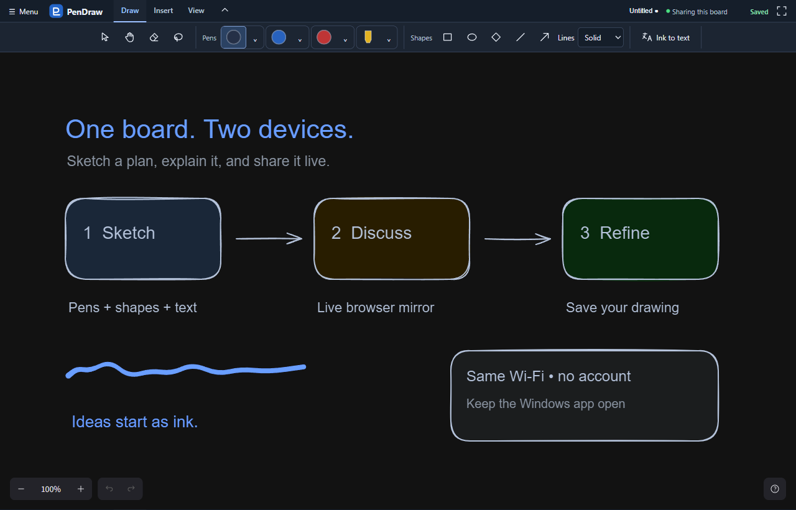
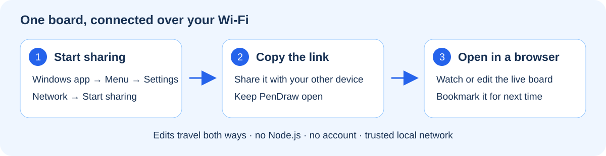
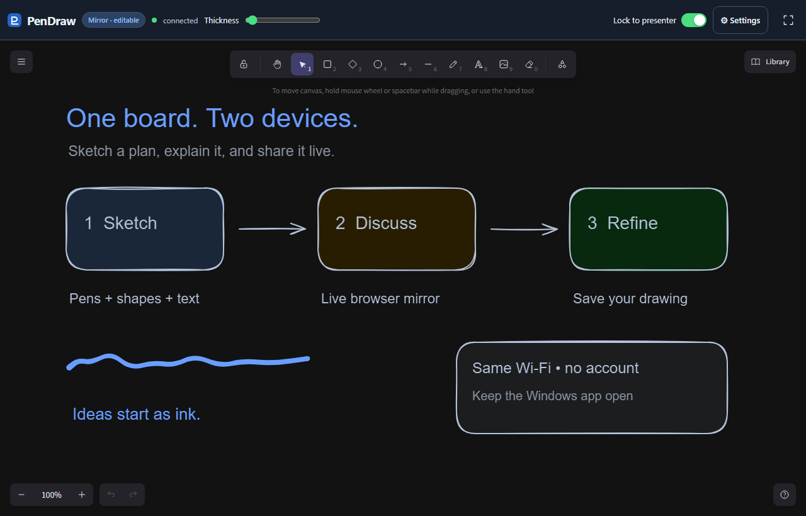
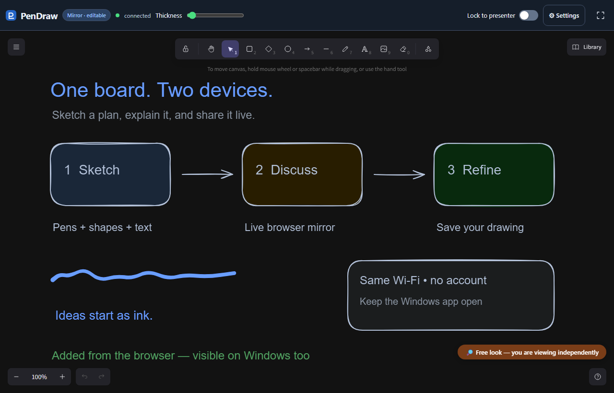
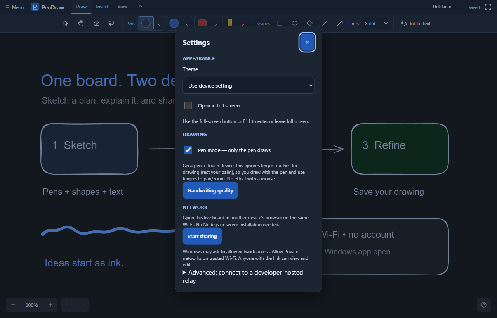

# PenDraw

**Sketch on Windows. Share the same board in a browser.**

A free, pen-first whiteboard for notes, diagrams and explaining ideas together. Draw with a pen or mouse. On a pen-and-touch device, use fingers to move around the board.

[**Download the complete Windows app**](https://github.com/isaacmwaura/PenDraw-app/releases/download/v0.2.4/PenDraw-0.2.4-windows.zip) · [Release notes](https://github.com/isaacmwaura/PenDraw-app/releases/tag/v0.2.4) · [Build from source](BUILDING.md)

*Actual app screenshot with a synthetic example board.*

PenDraw is based on the [MIT-licensed Excalidraw drawing engine](https://github.com/excalidraw/excalidraw). It adds a Windows desktop app, pen and touch controls, Windows handwriting recognition, and built-in local-network sharing. PenDraw is an independent project, not an official Excalidraw release.

## Open it in three steps

1. Download the Windows ZIP above. This release is for **64-bit Windows 10/11 on an Intel or AMD PC**.
2. Right-click the ZIP → **Extract All**. Keep the extracted files together in a local folder.
3. Open **PenDraw.exe**. On first launch, review the terms for Microsoft's included browser engine and select **Agree and open** to continue.

**No Node.js, terminal commands, separate browser-engine download or installer is needed.** The ZIP includes the executable, its browser engine and license notices. It is larger than earlier downloads for this reason. Open the extracted app, not the EXE inside the ZIP. Keep the `WebView2` folder beside `PenDraw.exe`. You can create a desktop shortcut or pin the executable to Start for quicker access.

### If Windows flags the download

PenDraw is currently **unsigned**. Windows may show an unrecognized-app warning. Download from this repository's official release page. If you trust that download and SmartScreen offers **More info → Run anyway**, use it for this app. Do not disable Windows security. If your organization or Smart App Control blocks it without that option, follow your administrator's policy. The release also supplies a SHA-256 checksum to compare file identity. A matching checksum is not a safety certification. [Microsoft explains these warnings](https://learn.microsoft.com/en-us/windows/apps/package-and-deploy/smartscreen-reputation).

## What can I do with it?

| Task | Where to find it |
|---|---|
| Write and sketch | **Draw** → three saved pens and a highlighter. Each has its own colour and width. |
| Create a diagram | **Draw** → rectangles, ellipses, diamonds, lines and arrows. |
| Add typed notes or a picture | **Insert** → drag a text box or add an image. Text boxes wrap when resized. |
| Colour a closed outline | **Insert** → fill. Clear, closed outlines work best. |
| Rearrange or reuse part of a board | Select objects, then open their context menu. Move, duplicate, delete, change layers or export. |
| Turn handwriting into typed text | Select ink → **Ink to text** → inspect the preview → convert. Keep unwanted blocks as ink. Windows desktop only; accuracy depends on your handwriting and available Windows recognition support. |
| Make more drawing room | Collapse the ribbon, or use **F11** for full screen. |
| Save or export | **Menu** → Save/Save As for an editable `.excalidraw` file. Export PNG for an image. |

**Recovery is a safety net, not a named file.** The app keeps a local recovery copy, but use **Save** when you want a drawing file to keep or send. Library items, recovery and preferences stay on that device.

## Share the board live

1. Connect the Windows PC and the other device to the **same trusted Wi-Fi or local network**.
2. In PenDraw, open **Menu → Settings → Network → Start sharing**.
3. Select **Copy link**, send the link to your other device or collaborator, and open it in an existing browser. Keep PenDraw open and sharing on.

**The Windows app hosts the mirror itself.** The other device only needs a browser. There is no account, cloud server or Node.js installation in this flow.

| Windows app | Browser mirror |
|---|---|
|  |  |
| Draw and present from the PC. | Watch or contribute from another browser. |

The mirror is **editable**, so a collaborator can add to the same board. **Lock to presenter** follows the PC's pan and zoom. Turn it off for **Free look** to navigate independently. Drawing on the mirror also switches it to Free look.

*This note was added in the browser and verified to appear in the Windows app too.*

### Make returning easier

- **Bookmark the sharing link** in the browser. You can also create a browser shortcut or add it to the device's home screen where supported. Open PenDraw and start sharing again before using it.
- Settings also offers a **computer-name link**. If your network resolves computer names, that link can keep working when the PC's numeric Wi-Fi address changes. Try it once before bookmarking it.
- If the numeric address changes, stop and start sharing, then copy the new link from Settings. After restarting sharing, refresh the mirror page to join the new session. Save any offline edits or use **Download backup** before reconnecting.
- Keep the PC awake during a session. Sharing ends when you select **Stop sharing**, use **New/Open**, or close PenDraw. It starts off each time you launch the app.

### Windows network access and connection problems

The first **Start sharing** may trigger a Windows firewall prompt. Allow **PenDraw on Private networks** when using trusted Wi-Fi. You do not need to allow Public networks for this use. Guest Wi-Fi often prevents devices from reaching each other. A VPN or organization policy may also block the connection. If a link fails, check those conditions and try the numeric sharing link.

Sharing links grant **view and edit access** to anyone who has them and can reach the host. Reusable links remain valid for future sessions whenever sharing is on. Local sharing is not encrypted. Keep links private and do not forward port 4000 from your router or expose the host to the internet. [Security details](SECURITY.md).

## Configure your workspace

| Setting | What it changes |
|---|---|
| **Settings → Appearance** | Light, Dark or the device's theme. Choose whether to open in full screen. |
| **Settings → Pen mode** | The pen draws while fingers navigate on a pen-and-touch device. Mouse use still works. |
| **Pen dropdowns** | Save a colour and width for each pen and the highlighter. |
| **View → Guides** | Add drawing guides and adjust spacing. |
| **View → Straighten** | Straighten a long, nearly straight stroke held before release. Short handwriting stays ink. |
| **Settings → Handwriting quality** | Record sample handwriting and compare Windows recognition results. |
| **Settings → Network** | Start/stop built-in sharing and copy the link. The contributor connection is an optional advanced flow for the developer-hosted relay. |

## Source and licenses

For installation of developer tools, source builds, the optional Node relay and automated checks, see [BUILDING.md](BUILDING.md). Those tools are **for developers**, not required by the complete Windows download.

PenDraw's source is [MIT licensed](LICENSE). You may use, modify, redistribute and sell copies while retaining the required notices. Dependencies retain their own licenses. The complete Windows package includes proprietary **Microsoft WebView2** under its [separate terms](licenses/Microsoft-WebView2/LICENSE.txt). Those terms do not replace the source's MIT license. Distributors must preserve the runtime's terms and required notices.

The included runtime contains Microsoft Defender SmartScreen and collects and sends user information to Microsoft as described in the [Microsoft privacy statement](https://aka.ms/privacy) and [SmartScreen privacy explanation](https://learn.microsoft.com/en-us/microsoft-edge/privacy-whitepaper#smartscreen). Fixed runtime updates arrive with new PenDraw packages; keep the app updated. See [third-party notices](THIRD_PARTY_NOTICES.md).
